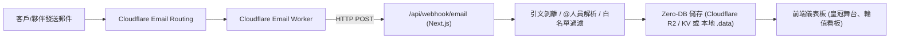

# Cloudflare 完整設定與部署指南

本系統（郵件智慧派工與動態輪值追蹤系統 Zero-DB Edition）具備**免傳統資料庫架構**，可直接搭配 **Cloudflare Email Routing** 與 **Cloudflare R2 / KV** 運作，亦支援本地自動 Fallback 開發。

---

## 快速目錄
1. [架構概覽](#1-架構概覽)
2. [Cloudflare Email Routing 與 Email Worker 設定](#2-cloudflare-email-routing-與-email-worker-設定)
3. [Cloudflare R2 儲存設定 (推薦)](#3-cloudflare-r2-儲存設定-推薦)
4. [Cloudflare KV 替代設定 (選項 B)](#4-cloudflare-kv-替代設定-選項-b)
5. [環境變數清單 (.env)](#5-環境變數清單-env)
6. [本地測試與開發](#6-本地測試與開發)

---

## 1. 架構概覽



---

## 2. Cloudflare Email Routing 與 Email Worker 設定

### 步驟 2.1：啟用 Email Routing
1. 登入 [Cloudflare Dashboard](https://dash.cloudflare.com/)。
2. 進入您的網域（例如 `yourdomain.com`）。
3. 在左側選單點選 **Email Routing（電子郵件路由）**。
4. 點選 **Enable Email Routing**，Cloudflare 會自動為您的網域添加必要的 DNS 紀錄（MX 與 SPF TXT 紀錄）。

### 步驟 2.2：建立 Email Worker
1. 在左側選單點選 **Workers & Pages** -> **Overview** -> **Create application** -> **Create Worker**。
2. 將 Worker 命名為 `email-dispatch-worker`。
3. 點選 **Deploy**，接著點選 **Edit code**。
4. 將專案中的 `cloudflare/email-worker.ts` 內容複製貼上替換。
5. 在 Worker 的 **Settings** -> **Variables** 中新增環境變數：
   - `WEBHOOK_URL`：您部署的 Next.js 網址加上路徑，例如：`https://your-app.vercel.app/api/webhook/email`
   - `WEBHOOK_SECRET`：（可選）自訂一組安全性金鑰，如 `my-secret-key-123`
6. 點選 **Save and deploy**。

### 步驟 2.3：綁定 Email Routing 路由規則
1. 回到網域的 **Email Routing** -> **Routing rules** 分頁。
2. 點選 **Create rule**：
   - **Custom address**：輸入您要接收派工信的信箱前綴，例如 `dispatch@yourdomain.com` 或 `support@yourdomain.com`（亦可選擇 Catch-all 接收所有未定義信箱）。
   - **Action**：選擇 **Send to a Worker**。
   - **Destination**：選擇剛才建立的 `email-dispatch-worker`。
3. 點選 **Save** 啟用規則。

> 💡 **完成！** 此後所有寄到該地址的郵件都會自動透過 Worker 解析並傳送到系統的 Webhook。

---

## 3. Cloudflare R2 儲存設定 (推薦)

本系統使用單一 JSON 檔案儲存完整系統狀態。使用 Cloudflare R2（提供每月 10GB 免費額度，零出口流量費）作為雲端儲存中心：

### 步驟 3.1：建立 R2 Bucket
1. 進入 Cloudflare Dashboard 左側選單 **R2 Object Storage**。
2. 點選 **Create bucket**。
3. Bucket 名稱輸入：`email-dispatch-bucket`。
4. 點選 **Create Bucket**。

### 步驟 3.2：建立 R2 API 憑證 (S3 相容)
1. 在 R2 頁面右側點選 **Manage R2 API Tokens**。
2. 點選 **Create API Token**。
3. 權限選擇 **Object Read & Write**，存留期可設為永久或依需求設定。
4. 點選 **Create API Token**。
5. 複製產生的：
   - **Access Key ID**
   - **Secret Access Key**
   - **Account ID**（在端點網址 `https://<ACCOUNT_ID>.r2.cloudflarestorage.com` 中可見）

### 步驟 3.3：於 Next.js 設定環境變數
在 Vercel 或本機的 `.env.local` 中填入：
```env
CF_R2_ACCOUNT_ID=你的_Cloudflare_Account_ID
CF_R2_ACCESS_KEY_ID=你的_R2_Access_Key_ID
CF_R2_SECRET_ACCESS_KEY=你的_R2_Secret_Access_Key
CF_R2_BUCKET=email-dispatch-bucket
CF_R2_KEY=system_state.json
```

---

## 4. Cloudflare KV 替代設定 (選項 B)

若您偏好使用 Cloudflare KV：
1. 進入 **Workers & Pages** -> **KV** -> **Create namespace**，命名為 `EMAIL_STATE`。
2. 前往 **My Profile** -> **API Tokens** -> **Create Token**，選擇 **Edit Cloudflare Workers** 範本。
3. 於 `.env.local` 設定：
```env
CF_KV_ACCOUNT_ID=你的_Cloudflare_Account_ID
CF_KV_NAMESPACE_ID=你的_KV_Namespace_ID
CF_KV_API_TOKEN=你的_Cloudflare_API_Token
CF_KV_KEY=system_state
```

---

## 5. 環境變數清單 (.env)

系統具備**智慧自動判斷**：
- 若未提供 Cloudflare 相關變數，系統將**自動 Fallback** 使用本地端檔案 `.data/system_state.json`，無需設定任何外部帳號即可 100% 正常運作！

| 變數名稱 | 必填 | 說明 |
|---|---|---|
| `CF_R2_ACCOUNT_ID` | 選用 | Cloudflare Account ID (使用 R2 儲存時) |
| `CF_R2_ACCESS_KEY_ID` | 選用 | R2 S3 相容 Access Key ID |
| `CF_R2_SECRET_ACCESS_KEY` | 選用 | R2 S3 相容 Secret Access Key |
| `CF_R2_BUCKET` | 選用 | R2 Bucket 名稱 (如 `email-dispatch-bucket`) |
| `CF_R2_KEY` | 選用 | R2 存儲鍵值 (預設 `system_state.json`) |
| `WEBHOOK_SECRET` | 選用 | Webhook 驗證金鑰，需與 Worker 的 `WEBHOOK_SECRET` 一致 |

---

## 6. 本地測試與開發

您可以直接在本機啟動專案進行全功能測試：
```bash
npm run dev
```
瀏覽器打開 `http://localhost:3000`：
1. 點擊頂部 **「郵件測試模擬器」**。
2. 點擊內建的快速範本（例如「指定派單 @建宏 P1 @Alex P2」、「平衡輪值」、「回信更新」）。
3. 點擊 **「🚀 發送至 Webhook」**，即可立即觀察即時剝離引文、SLA 到期計算、皇冠移交 👑 與名冊銷假動態平衡之運作！
